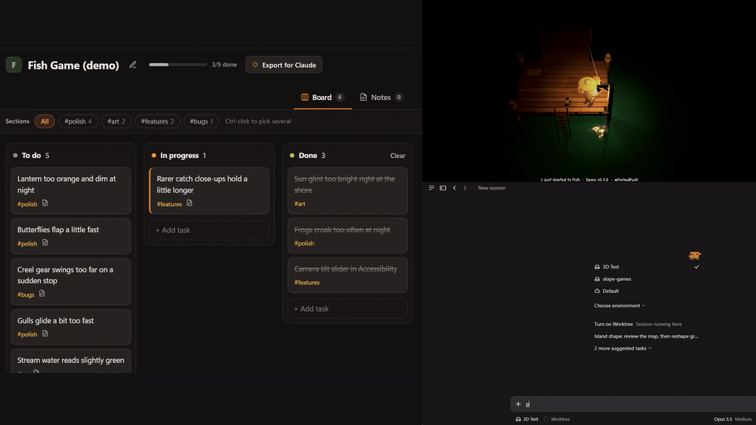

# ForkPad

A small, local notes app and Kanban board that Claude Code can read and update.

Write down bugs, ideas and tasks while you work (paste screenshots too), then tell Claude Code "fix the open ForkPad bugs". Claude reads the tasks and screenshots, makes the fixes in your code and moves the cards to Done with a note of what changed. You watch the board update live.



- Everything stays on your computer as plain JSON files. No account, no cloud, no tracking.
- No npm install and no build step: just Node.js and a browser.
- Works on Windows, macOS and Linux.

## Features

- **Projects** with a Kanban board (To do / In progress / Done) and project notes
- **Notes**: rich text, checklists, code blocks, links, pasted or dropped screenshots, tags, pinning
- **Sections**: tag notes and tasks (`#bugs`, `#ideas`, ...) and filter a project by them
- **GDD boards**: a visual Game Design Document for each game idea. An open canvas with sections, sticky notes and text bubbles, images with borders (set a default border once and new images follow it), simple shapes, arrows and lines between anything, and a pen to doodle over it all. Start from a GDD template or a blank board, and link it to a project
- **Quick thoughts**: `Alt+Q`, type, Enter. Turn them into notes or tasks later
- **Upcoming**: everything with a due date, across all projects
- **Search**: `Ctrl+K` matches text, projects and `#tags`
- **Export for Claude**: copy a Markdown brief of a project, a section or a note, or download it as a `.zip` with the screenshots
- **Claude Code connector** (MCP) with 30 tools: list, read, add, edit, move, complete and delete projects, tasks, notes and quick thoughts, view screenshots, and read, fill in and plan from GDD boards
- **Live sync**: changes Claude makes show up in an open ForkPad window within about a second

## Requirements

- [Node.js](https://nodejs.org) 20 or newer
- A browser. Chrome, Edge, Chromium or Brave give ForkPad its own window. Otherwise it opens in a tab of your default browser.
- [Claude Code](https://claude.com/claude-code) if you want the connector

## Install

Download the code with git:

```bash
git clone https://github.com/forkedcrab/forkpad.git
```

Or on GitHub, click **Code > Download ZIP** and unzip it somewhere you'll keep it, for example `Documents/forkpad`.

## Start ForkPad

### Windows

Double-click **`ForkPad.vbs`** in the folder. It starts ForkPad with no console window. For a Desktop shortcut, right-click `ForkPad.vbs` > **Show more options** > **Send to** > **Desktop (create shortcut)**.

### macOS

Open Terminal in the ForkPad folder and run this once to make the launcher executable:

```bash
chmod +x ForkPad.command
```

Then double-click **`ForkPad.command`** in Finder. The first time, macOS may block it: right-click it > **Open** > **Open**.

### Linux

```bash
chmod +x forkpad.sh
```

```bash
./forkpad.sh
```

### Any OS, from a terminal

```bash
npm start
```

This is the same as `node server/start.js`.

### How it runs

The launcher starts a small helper (`server/forkpad-server.js`) on `http://127.0.0.1:47821` and opens the app. The helper only listens on your own computer and stops by itself about a minute after you close the last ForkPad window. To use another port, set `FORKPAD_PORT`.

## Connect Claude Code

Register the connector once, for every Claude Code session on your computer. Use the full path to your ForkPad folder:

**Windows**

```bash
claude mcp add --scope user forkpad -- node C:\path\to\forkpad\mcp\forkpad-mcp.js
```

**macOS / Linux**

```bash
claude mcp add --scope user forkpad -- node /path/to/forkpad/mcp/forkpad-mcp.js
```

Check it with `claude mcp list`: `forkpad` should show as connected. Sessions that were already open need a restart (or `/mcp`) to see it.

The connector reads and writes the `data` folder directly, so ForkPad doesn't need to be open.

### Link a project to your code

In ForkPad, edit a project (pencil next to its name) and set **Code folder** to your project's folder. A Claude session opened in that folder then knows which ForkPad project it belongs to. You can also ask Claude: "link this folder to the My Game project in ForkPad".

### Things to ask Claude

- "Fix the open ForkPad bugs"
- "What's left on the board in ForkPad?"
- "Add a ForkPad task: enemy AI too aggressive, tag it bugs"
- "Write a ForkPad note summarising what we changed today"
- "Make a ForkPad project called Demo, blue, linked to this folder"
- "Read my GDD Space Snail and make a project with tasks"
- "Add a Bosses section to the Space Snail GDD with a note for each boss"
- "Which tasks from the Space Snail GDD are still open?"

Claude reads a GDD board as structured text (sections, notes, connections, linked tasks) plus a snapshot image of the whole board, so it sees your images and doodles too. Tasks it makes from a board stay linked to the board item they implement, and the board shows them.

Claude only deletes projects, tasks, notes or GDD boards when you ask it to. Deleting a project also deletes its tasks and notes, but keeps its GDD boards (they just lose the project link).

## Use it with other AI tools

The connector is a standard local MCP server with nothing Claude-specific in it, so any app that supports local (stdio) MCP servers can use it. The command is always the same: `node /path/to/forkpad/mcp/forkpad-mcp.js`.

**Codex** (OpenAI's coding agent: CLI, IDE extension, desktop)

```bash
codex mcp add forkpad -- node /path/to/forkpad/mcp/forkpad-mcp.js
```

Or add it to `~/.codex/config.toml`:

```toml
[mcp_servers.forkpad]
command = "node"
args = ["/path/to/forkpad/mcp/forkpad-mcp.js"]
```

**Claude Desktop, Cursor, Windsurf**: add this to the app's MCP settings (`claude_desktop_config.json`, `~/.cursor/mcp.json` or `~/.codeium/windsurf/mcp_config.json`):

```json
{
  "mcpServers": {
    "forkpad": { "command": "node", "args": ["/path/to/forkpad/mcp/forkpad-mcp.js"] }
  }
}
```

**VS Code** (Copilot agent mode): the same entry goes in `.vscode/mcp.json`, under `"servers"` instead of `"mcpServers"`.

On Windows, write the path with forward slashes or doubled backslashes inside JSON and TOML, for example `"C:/path/to/forkpad/mcp/forkpad-mcp.js"`.

Apps that don't run inside your code folder (such as Claude Desktop) can't pick the project from the folder, so name the project when you ask, for example "list the open bugs in the My Game project in ForkPad".

**ChatGPT** (website or chat app) doesn't work directly: it only connects to connectors hosted online over HTTPS, and putting your notes on the internet goes against ForkPad's local-only design. Use Codex instead.

Only Claude Code has been tested so far. Reports from other apps are welcome.

## Your data

Everything lives in the `data` folder inside ForkPad:

- `projects/`, `notes/`, `tasks/`, `boards/` (GDD boards): one `.json` file per item
- `images/`: pasted screenshots, images on GDD boards and board snapshots
- `meta/`: preferences

Back up the `data` folder now and then, or use **Backup & data** (bottom left) > **Export backup**. To keep your data somewhere else, set the `FORKPAD_DATA` environment variable to a folder path before starting ForkPad, and pass the same folder to the connector: `claude mcp add --scope user -e FORKPAD_DATA=/path/to/folder forkpad -- node ...`.

## Files

- `index.html`, `style.css`, `app.js`: the app
- `gdd.js`, `gdd.css`: the GDD board editor; `gdd-render.js`: board snapshots and PNG export; `gdd-model.js`: the board data model, shared with the connector
- `db.js`: storage in the app (talks to the helper)
- `server/forkpad-server.js`: the local helper; `server/store.js`: file storage shared with the connector; `server/start.js`: cross-platform launcher
- `mcp/forkpad-mcp.js`, `mcp/md.js`: the Claude Code connector (MCP over stdio, no dependencies)
- `ForkPad.vbs` (Windows), `ForkPad.command` (macOS), `forkpad.sh` (Linux): launchers

## License

[MIT](LICENSE)
